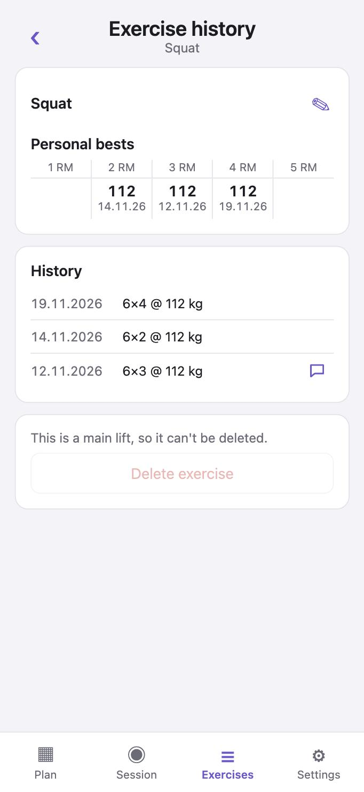
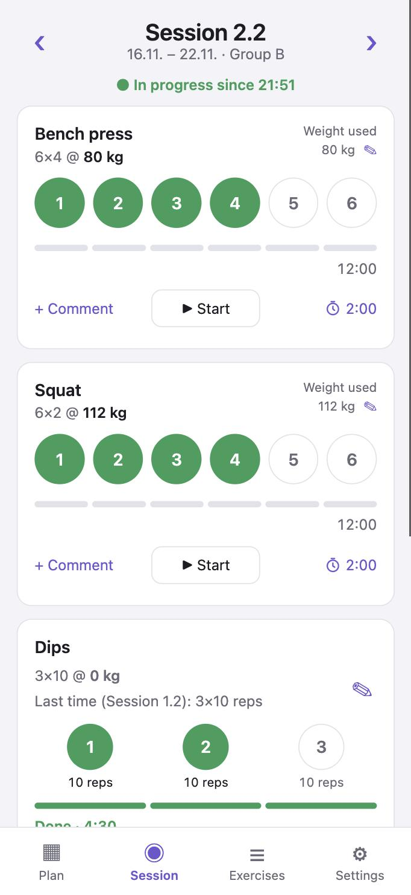
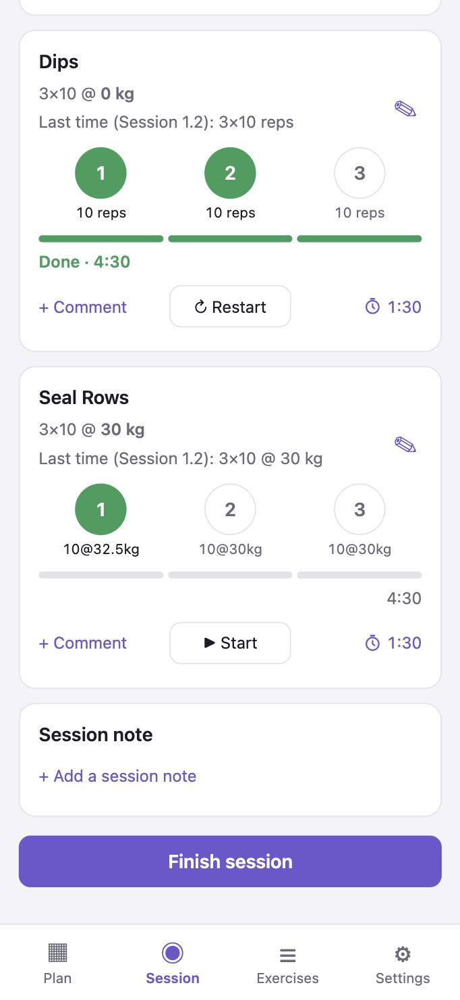
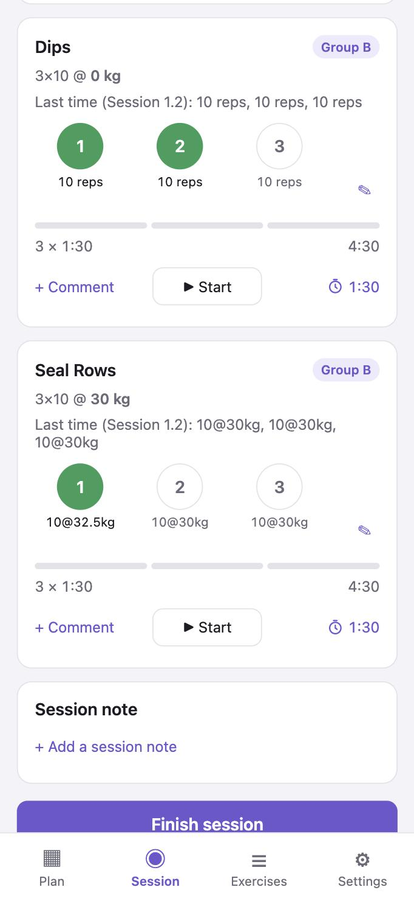
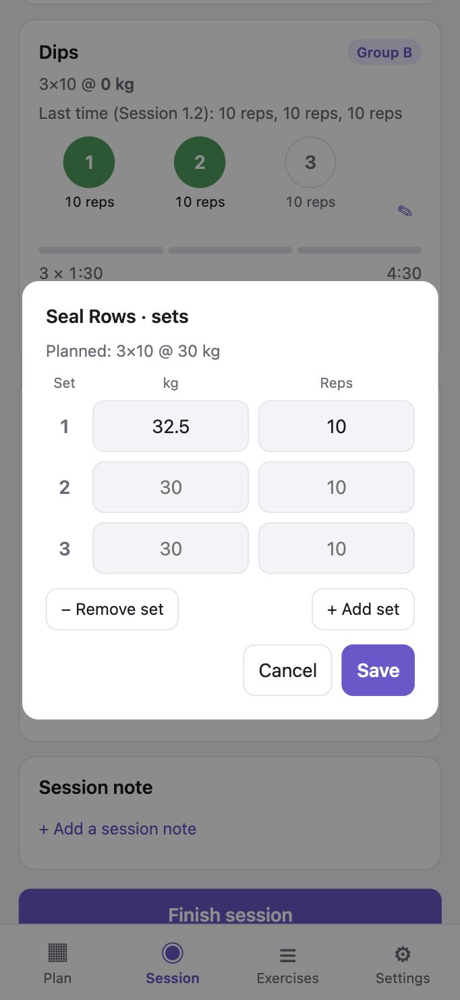
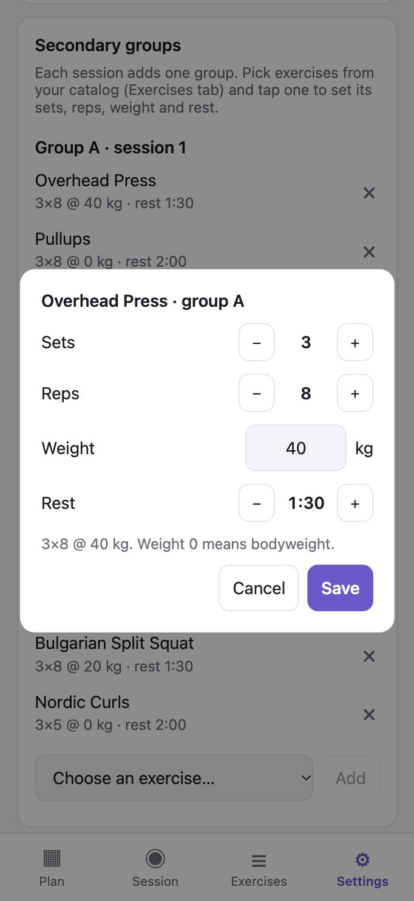
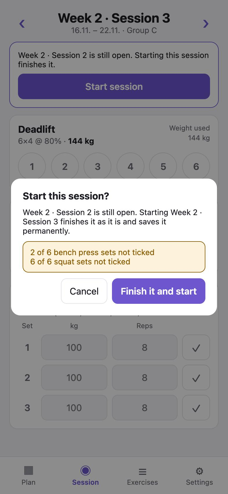
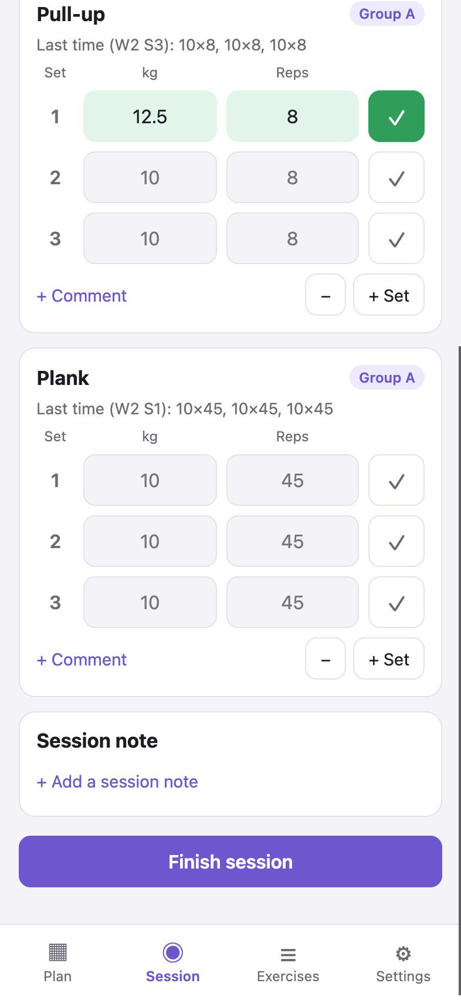
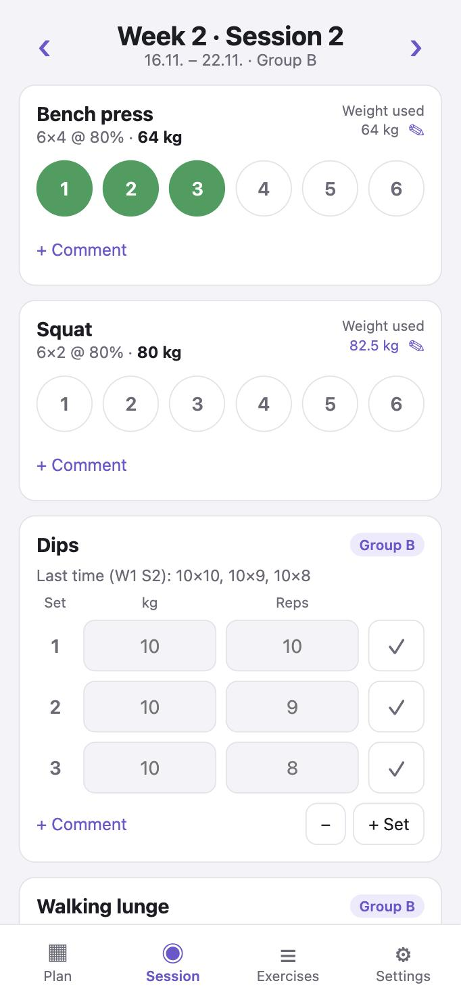
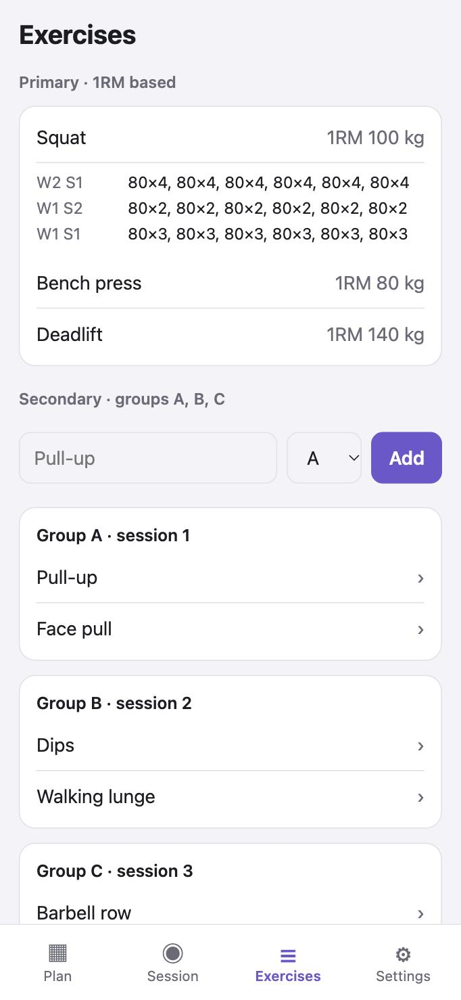

# Changelog

How the Training Cycle App develops over time. Each version lists what changed and shows the app at
that point (screenshots taken at iPhone 14 Pro size with demo data).

Versions follow [semantic versioning](https://semver.org/): `0.x` while the app is taking shape,
a minor bump (0.**2**.0) for new features, a patch bump (0.1.**1**) for small fixes and tweaks.
The current version is shown at the bottom of **Settings**.

---

## 0.7.0 — 2026-11-21 · Exercise history and personal bests

Each exercise gets its own history with personal bests, dates can be shown US-style, and the
app can be filled with sample data to try it out.

| Exercise history | Comment | Session | Plan |
|---|---|---|---|
|  |  |  |  |

| Settings |
|---|
|  |

### Added
- **Exercise history** (Exercises → tap an exercise): every finished session the exercise was
  done in, newest first, as date and done sets ("6×4 @ 112 kg", same format as "Last time").
  A bubble icon opens the comment written on that card.
- **Personal bests**: the heaviest ticked set for exactly 1, 2, 3, 4 and 5 reps, each with the
  date it was first lifted. Empty means never done for that many reps; 0 means bodyweight.
- **Date format** in Settings → Preferences: 31.12. or 12/31, for week ranges, finished
  sessions and the history.
- **Use sample data** in Settings → Backup: a cycle in its second week with four finished
  sessions and Session 2.2 in progress today. Replaces the current data after a confirmation and
  keeps your unit and date format.

### Changed
- The exercise name is shown as text with a pen that opens a rename dialog; Delete moved to its
  own card at the bottom.
- The Units card is now **Preferences**, with a quieter switch (white pill on a gray track).

---

## 0.6.0 — 2026-11-21 · Units and tidier cards

Main lifts and accessory work now use the same "3×10 @ 30 kg" style, "Last time" is a compact
summary, and weights can be labelled in kg or lbs.

| Session | Accessory work | Plan |
|---|---|---|
|  |  |  |

| Accessory work (Settings) | Units |
|---|---|
|  |  |

### Added
- **Units** card in Settings, between Backup and Reset: switch between kg and lbs. It changes the
  label everywhere (history included); numbers are not converted.

### Changed
- Main lifts show their prescription as "6×4 @ 80 kg" instead of percentages, on the Session
  card, in finished sessions and in the Plan's Next up card.
- "Last time" on accessory cards is a compact summary: sets with the same weight are grouped in
  order, equal reps as "3×10", different reps as "10-9-7", e.g. "2×10 @ 40 kg, 10-7 @ 45 kg".
  Bodyweight-only work reads "3×10 reps". Only ticked sets count.
- Accessory cards: the pen sits beside the two text lines and is larger, and the set columns line
  up with the timer segments below.
- "Secondary groups" is now called **Accessory work**.

### Removed
- The group pill on accessory cards and the "sets × interval" text on the timer.

---

## 0.5.0 — 2026-11-20 · Rest timer and prescribed accessories

Every exercise card gets an interval timer, secondary exercises get a prescription, and their
cards are much more compact. The app is now online at
[mrnh.github.io/training-cycle-app-react](https://mrnh.github.io/training-cycle-app-react/).

| Session | Secondary exercises | Editing sets | Plan |
|---|---|---|---|
|  |  |  |  |

| Groups (Settings) | Prescription | Exercises |
|---|---|---|
|  |  |  |

### Added
- **Rest timer** on every exercise card in the open session: a bar with one segment per set,
  "Set 2 · 1:12 left" and the total time. Start runs it for interval × sets; ticking sets doesn't
  change it. Pause / Resume, and a reset icon while paused. One timer runs at a time, and it
  keeps the right time after a reload or switching apps. The clock (default 2:00) opens a dialog
  to set the interval, 0:15 to 10:00 in 15-second steps.
- **Prescriptions for secondary exercises:** in Settings, each group entry holds sets, reps,
  weight (0 = bodyweight) and its rest interval, edited in a dialog. Session cards show it
  ("3×10 @ 30 kg"), pre-fill the sets with it and start the timer with its rest time. "Last time"
  stays as a reference. Finished sessions keep the prescription they had.
- **Ten more default exercises:** Back Extensions, Bulgarian Split Squat, Dips, Nordic Curls,
  Overhead Press, Pullups, Reverse Nordic Curls, Seal Rows, Tuck-Ups and V-Ups.
- **Online version** on GitHub Pages, published automatically from every push to `main`. Data
  still stays on each device.

### Changed
- **Compact secondary cards:** numbered set toggles like the main lifts, each set's values under
  it, and a pen that opens a dialog to edit weight and reps of all sets and add or remove sets.
- Sessions are named "Session 1.2" everywhere (was "W1 S2" and "Week 1 · Session 2").
- Sets are written reps@weight ("8@15kg"), matching "6×4 @ 80%"; without external weight just
  "10 reps".
- Finish dialog: "Marking this session as finished prevents it from being changed afterwards."
- All sizes, colours, weights and spacing come from one set of design tokens (`index.css`):
  five text sizes, two weights, a 4px spacing scale.

### Data
- Group entries now store their prescription and rest; existing ones get 3×10 @ 0 kg and 2:00.
  The new default exercises are added unless one with the same name exists. A copy of the data
  from before each conversion is kept on the device.

---

## 0.4.0 — 2026-11-20 · Starting a session

Sessions are now started and finished in order, with only one open at a time.

| Plan | Session in progress | Starting the next one | Preview |
|---|---|---|---|
|  |  |  |  |

### Added
- **Start session:** the next session in order has a "Start session" button at the top. Only a
  started session can be logged, and only it shows "Finish session" at the bottom. It shows
  when it was started ("In progress since 18:05").
- **One open session at a time:** starting the next session while one is still open finishes the
  open one as it is, after a dialog that lists its main-lift sets not ticked.
- **Preview:** every other unfinished session shows its planned lifts, weights and secondary
  exercises without any controls, and links to the session to do first.

### Changed
- Plan: the top card says "In progress" while a session is open, otherwise "Next up". The open
  session's dot is light green.
- The Session tab opens the session in progress, otherwise the next one to start.

### Data
- Each cycle stores its open session. Sessions that were started but not finished before this
  version are removed when the data is converted; finished sessions stay. A copy of the data from
  before the conversion is kept on the device.

---

## 0.3.0 — 2026-11-19 · Exercise catalog and finishing sessions

Exercises now live in one catalog that the groups pick from, and a session is saved permanently
once you finish it.

| Plan | Session | Finishing | Finished session |
|---|---|---|---|
|  |  |  |  |

| Exercises | One exercise | Groups (Settings) | Cycle complete |
|---|---|---|---|
|  |  |  |  |

### Added
- **Exercise catalog:** the Exercises tab lists every exercise, including squat, bench press and
  deadlift. Each row opens the exercise's screen (rename and delete for now; its history comes
  later). Deleting is blocked while an exercise is a main lift or in a group.
- **Groups in Settings:** groups A, B and C pick exercises from the catalog. One exercise can be in
  several groups, and a main lift can also be a secondary exercise.
- **Finish session:** an open session is a draft that is saved on every tap. "Finish session"
  (confirmed in a dialog that lists main-lift sets not ticked) saves it permanently. Finished
  sessions are shown read-only, and later group or name changes don't affect them.
- **Cycle complete:** once week 9 session 3 is finished, Plan shows the new 1RMs and "Start next
  cycle". A re-test that wasn't ticked keeps the old 1RM.

### Changed
- Plan dots, "x of 27 sessions done", "last time" hints and the re-test results count finished
  sessions only.
- Each cycle stores which exercises are its three main lifts (squat, bench press and deadlift;
  there is no screen to change them yet).
- Tapping the tab you're on returns it to its first screen.

### Data
- Stored data and older backups are converted automatically. Sessions whose main-lift sets were
  all ticked become finished sessions; the rest stay drafts. A copy of the data from before each
  conversion is kept on the device.

---

## 0.2.0 — 2026-11-19 · Redesigned session cards

The main lifts in a session are now one compact card each: tap a numbered button per set instead
of filling in a row per set.

| Session | Changing the weight | Plan | Exercises | Settings |
|---|---|---|---|---|
|  |  |  |  |  |

### Changed
- **Main-lift cards:** one card per lift with numbered set buttons (48 px) spread across the card,
  instead of a row with weight, reps and tick for every set. Ticked sets turn green.
- **Prescription line** "6×3 @ 80% · **80 kg**": the planned weight is bold, in the lift name's
  colour (black, or white in dark mode).
- **Weight used** is shown top right as text with a pen icon, aligned with its label. Removed the
  "Variant" pill and the reps field (reps come from the prescription).

### Added
- **Weight dialog:** the pen opens a dialog showing the planned weight, with a number field,
  "Use planned weight", Cancel and Save. The new weight applies to all sets of that lift; a weight
  that differs from the plan is shown in purple.

### Fixed
- Exercise history and "last time" only count sets that were actually ticked. Before, changing the
  weight of a lift before training showed up as six empty sets in its history.

---

## 0.1.0 — 2026-11-19 · First version

The first usable version: a 9-week cycle of the Russian Masters Squat Routine, adapted for squat,
bench press and deadlift, with three sessions a week.

| Plan | Session | Secondary exercises | Exercises | Settings |
|---|---|---|---|---|
|  |  |  |  |  |

### Added
- **Plan:** "Next up" card, 9 weeks × 3 sessions with dates (`23.11. – 29.11.`), session dots for
  done / next / started, and a progress bar with "x of 27 sessions done". Fits one iPhone screen
  without scrolling.
- **Session:** sets with weight, reps and a tick. Values save instantly — no "finish" button.
  Previous/next arrows to move between sessions.
- **Program rules:** each session pairs one lift's variant 2 (progressing volume, then intensity)
  with another lift's variant 1 (6×2 @ 80%). Weights are 1RM × %, rounded to one decimal.
- **Re-test:** the week-9 single at 105% becomes the 1RM for the next cycle; "Start next cycle"
  appears once all three re-tests are done, and old cycles stay in the history.
- **Secondary exercises** in groups A/B/C (one group per session), with "last time" hints,
  adjustable set count and per-exercise history.
- **Comments** per exercise and a note per session.
- **Settings:** start date and 1RM in one "Current cycle" box; 1RM editing behind the gear icon with
  a warning and Cancel/Save; backup export/import (JSON); delete all data; version number.
- **Storage:** everything is kept on the device in IndexedDB, works without a server.
- Mobile layout: bottom tab bar, large tap targets, light and dark mode, safe-area support.

### Fixed during development
- The Session tab no longer jumps to the next session when the last set is ticked.
- Date fields no longer overflow their box in iPhone Safari.
- Starting a cycle and adding exercises work when the app is opened over the local network (plain http).
