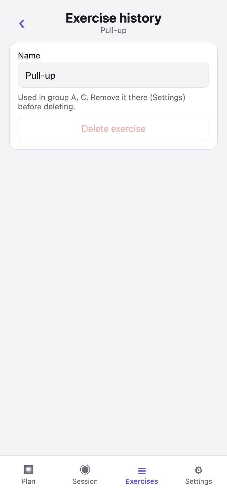
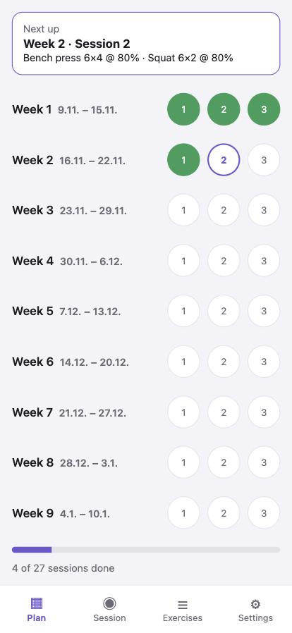
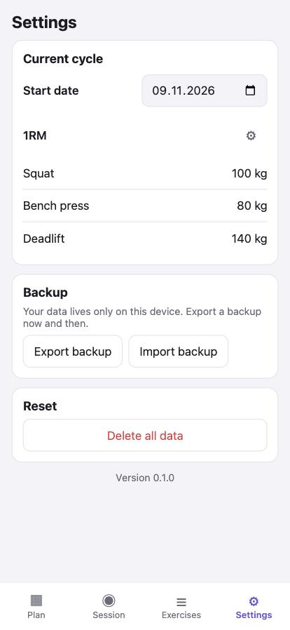

# Changelog

How the Training Cycle App develops over time. Each version lists what changed and shows the app at
that point (screenshots taken at iPhone 14 Pro size with demo data).

Versions follow [semantic versioning](https://semver.org/): `0.x` while the app is taking shape,
a minor bump (0.**2**.0) for new features, a patch bump (0.1.**1**) for small fixes and tweaks.
The current version is shown at the bottom of **Settings**.

---

## 0.3.0 — 2026-11-19 · Exercise catalog and finishing sessions

Exercises now live in one catalog that the groups pick from, and a session is saved permanently
once you finish it.

| Plan | Session | Finishing | Finished session |
|---|---|---|---|
|  |  |  |  |

| Exercises | One exercise | Groups (Settings) | Cycle complete |
|---|---|---|---|
|  |  |  |  |

### Added
- **Exercise catalog:** the Exercises tab lists every exercise, including squat, bench press and
  deadlift. Each row opens the exercise's screen (rename and delete for now; its history comes
  later). Deleting is blocked while an exercise is a main lift or in a group.
- **Groups in Settings:** groups A, B and C pick exercises from the catalog. One exercise can be in
  several groups, and a main lift can also be a secondary exercise.
- **Finish session:** an open session is a draft that is saved on every tap. "Finish session"
  (confirmed in a dialog that lists main-lift sets not ticked) saves it permanently. Finished
  sessions are shown read-only, and later group or name changes don't affect them.
- **Cycle complete:** once week 9 session 3 is finished, Plan shows the new 1RMs and "Start next
  cycle". A re-test that wasn't ticked keeps the old 1RM.

### Changed
- Plan dots, "x of 27 sessions done", "last time" hints and the re-test results count finished
  sessions only.
- Each cycle stores which exercises are its three main lifts (squat, bench press and deadlift;
  there is no screen to change them yet).
- Tapping the tab you're on returns it to its first screen.

### Data
- Stored data and older backups are converted automatically. Sessions whose main-lift sets were
  all ticked become finished sessions; the rest stay drafts. A copy of the data from before each
  conversion is kept on the device.

---

## 0.2.0 — 2026-11-19 · Redesigned session cards

The main lifts in a session are now one compact card each: tap a numbered button per set instead
of filling in a row per set.

| Session | Changing the weight | Plan | Exercises | Settings |
|---|---|---|---|---|
|  |  |  |  |  |

### Changed
- **Main-lift cards:** one card per lift with numbered set buttons (48 px) spread across the card,
  instead of a row with weight, reps and tick for every set. Ticked sets turn green.
- **Prescription line** "6×3 @ 80% · **80 kg**": the planned weight is bold, in the lift name's
  colour (black, or white in dark mode).
- **Weight used** is shown top right as text with a pen icon, aligned with its label. Removed the
  "Variant" pill and the reps field (reps come from the prescription).

### Added
- **Weight dialog:** the pen opens a dialog showing the planned weight, with a number field,
  "Use planned weight", Cancel and Save. The new weight applies to all sets of that lift; a weight
  that differs from the plan is shown in purple.

### Fixed
- Exercise history and "last time" only count sets that were actually ticked. Before, changing the
  weight of a lift before training showed up as six empty sets in its history.

---

## 0.1.0 — 2026-11-19 · First version

The first usable version: a 9-week cycle of the Russian Masters Squat Routine, adapted for squat,
bench press and deadlift, with three sessions a week.

| Plan | Session | Secondary exercises | Exercises | Settings |
|---|---|---|---|---|
|  |  |  |  |  |

### Added
- **Plan:** "Next up" card, 9 weeks × 3 sessions with dates (`23.11. – 29.11.`), session dots for
  done / next / started, and a progress bar with "x of 27 sessions done". Fits one iPhone screen
  without scrolling.
- **Session:** sets with weight, reps and a tick. Values save instantly — no "finish" button.
  Previous/next arrows to move between sessions.
- **Program rules:** each session pairs one lift's variant 2 (progressing volume, then intensity)
  with another lift's variant 1 (6×2 @ 80%). Weights are 1RM × %, rounded to one decimal.
- **Re-test:** the week-9 single at 105% becomes the 1RM for the next cycle; "Start next cycle"
  appears once all three re-tests are done, and old cycles stay in the history.
- **Secondary exercises** in groups A/B/C (one group per session), with "last time" hints,
  adjustable set count and per-exercise history.
- **Comments** per exercise and a note per session.
- **Settings:** start date and 1RM in one "Current cycle" box; 1RM editing behind the gear icon with
  a warning and Cancel/Save; backup export/import (JSON); delete all data; version number.
- **Storage:** everything is kept on the device in IndexedDB, works without a server.
- Mobile layout: bottom tab bar, large tap targets, light and dark mode, safe-area support.

### Fixed during development
- The Session tab no longer jumps to the next session when the last set is ticked.
- Date fields no longer overflow their box in iPhone Safari.
- Starting a cycle and adding exercises work when the app is opened over the local network (plain http).
