# Changelog

How the Training Cycle App develops over time. Each version lists what changed and shows the app at
that point (screenshots taken at iPhone 14 Pro size with demo data).

Versions follow [semantic versioning](https://semver.org/): `0.x` while the app is taking shape,
a minor bump (0.**2**.0) for new features, a patch bump (0.1.**1**) for small fixes and tweaks.
The current version is shown at the bottom of **Settings**.

---

## 0.20.0 — 2026-11-24 · Correct finished workouts

| Editing a workout | After the correction |
|---|---|
| 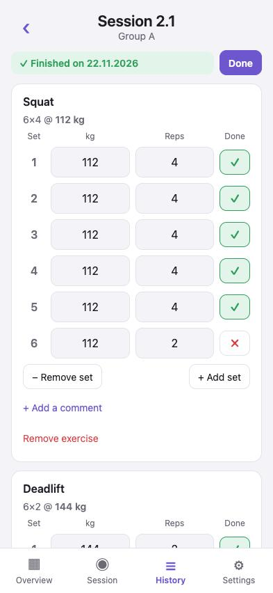 | 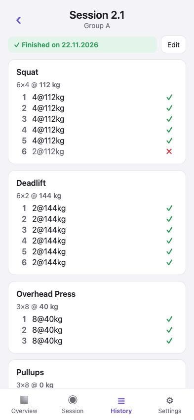 |

### Added
- **Edit** on a finished workout (next to the "Finished" banner) turns its cards into a form to
  fix what was logged wrong: weight, reps and done per set, **Add set** / **Remove set**, a
  comment per exercise, **Remove exercise**, **Add exercise** and the session note. Changes
  save straight away; **Done** ends editing.
- A correction only changes the record of that workout. The plan, the other sessions and the
  week-9 re-test result stay as they were, and the workout does not become open again.

### Changed
- The Finish dialog no longer says a finished session can't be changed.
- Behind the scenes: the week-9 re-test stores its result when the session is finished, so a
  later correction can't change the next cycle's 1RM.

---

## 0.19.0 — 2026-11-23 · Release notes on update

| Update bar | What's new |
|---|---|
| 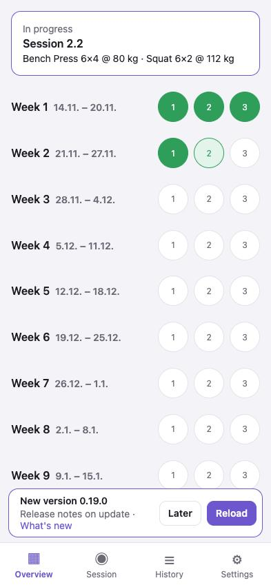 | 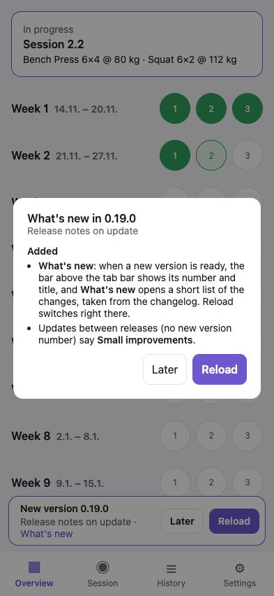 |

### Added
- **What's new**: when a new version is ready, the bar above the tab bar shows its number
  and title, and **What's new** opens a short list of the changes, taken from the changelog.
  Reload switches right there.
- Updates between releases (no new version number) say **Small improvements**.

---

## 0.18.1 — 2026-11-23 · Consistency pass

| All exercises | Settings |
|---|---|
| 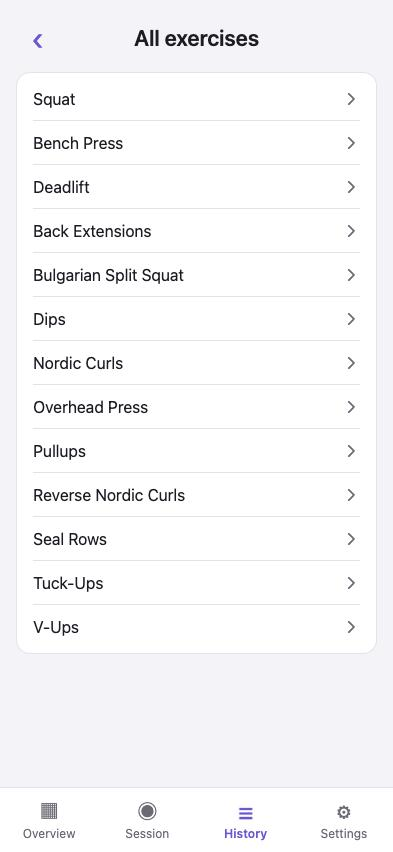 | 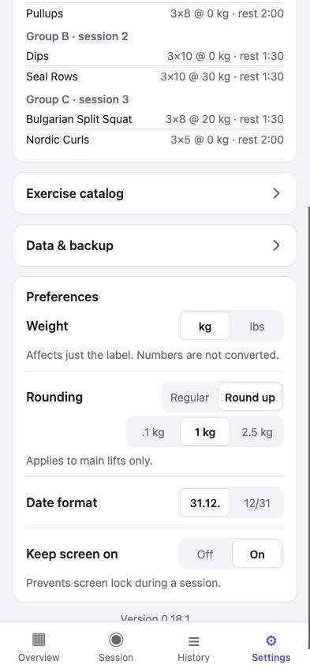 |

### Changed
- All exercises and the exercise catalog use the same chevron as the rest of the app, and all
  exercise lists share one row style (same height everywhere).
- "Data & Backup" is now **Data & backup**, like the other screen titles.
- Back buttons name the screen they return to (for VoiceOver); the accessory work editor's says
  "Back to current cycle", Exercise history's names the list it was opened from.
- Behind the scenes: one shared title bar for all screens below a tab, and duplicated styles
  merged.

---

## 0.18.0 — 2026-11-23 · Exercise history on the History tab

| Workout history | Exercise history | Picking exercises | All exercises |
|---|---|---|---|
| 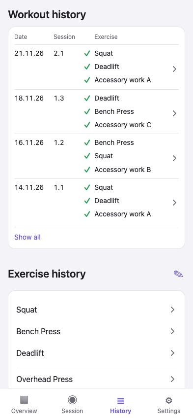 | 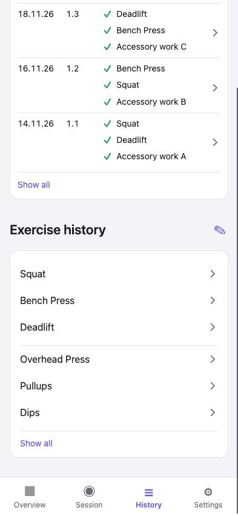 | 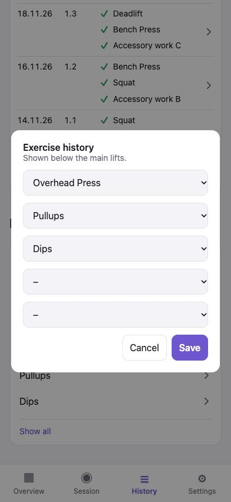 | 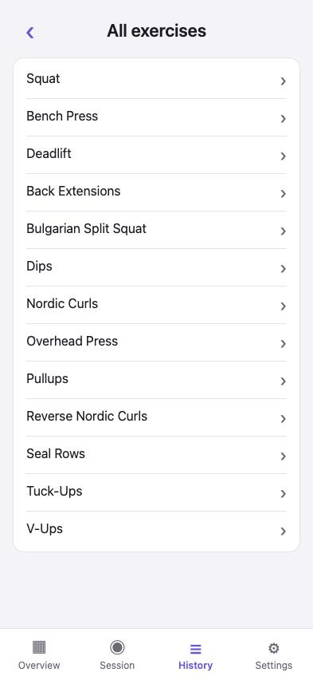 |

### Added
- **Exercise history** on the History tab: the main lifts, then up to five other exercises,
  each opening its exercise history. The ✎ next to the heading picks them in a dialog of
  dropdowns; until then the first three accessory exercises are shown. **Show all** opens
  **All exercises**, the exercise catalog list without the add field.

### Changed
- The History tab is headed **Workout history** and shows the **four** most recent workouts
  (Show all still lists every one).

---

## 0.17.0 — 2026-11-23 · Recent history, all workouts

| History | All workouts | Preferences |
|---|---|---|
| 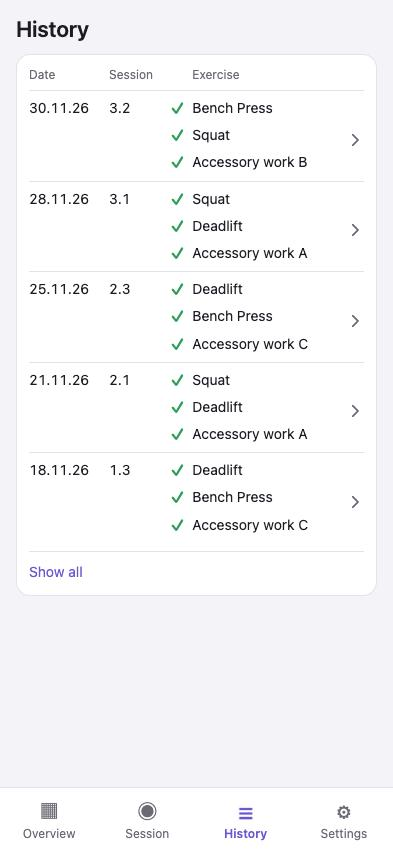 | 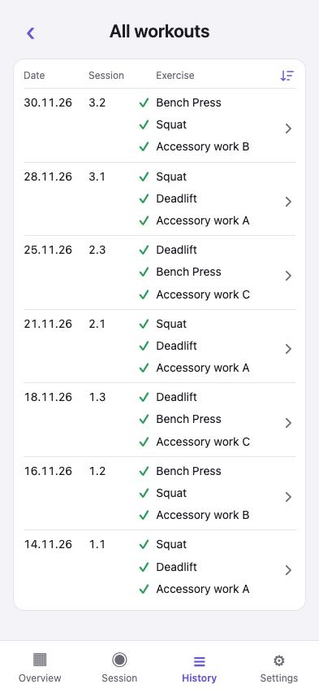 | 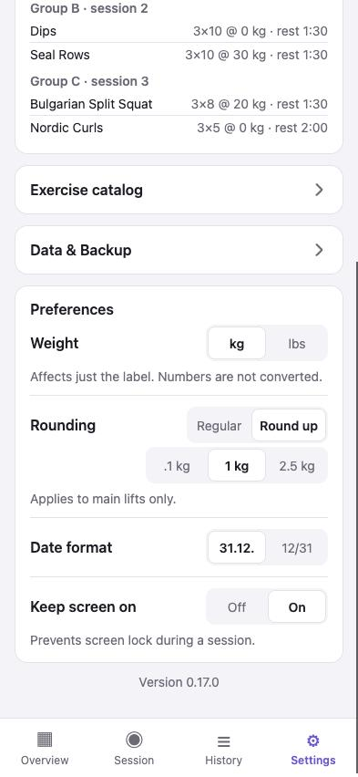 |

### Added
- **All workouts**: the History tab shows the five most recent workouts; **Show all** opens a
  screen with every workout. Its **sort button** shows newest or oldest first (newest first by
  default; the choice is remembered on the device).

### Changed
- History: a › on each workout shows it opens the session, and the checkmarks now stand before
  the exercise names.
- Preferences: divider lines between the settings, Date format now after Rounding, and shorter
  notes ("Affects just the label…", "Applies to main lifts only.", "Prevents screen lock during
  a session.").

---

## 0.16.0 — 2026-11-23 · Swipe back, tidier Settings

| Settings | Current cycle | Data & Backup | Swipe back |
|---|---|---|---|
|  | 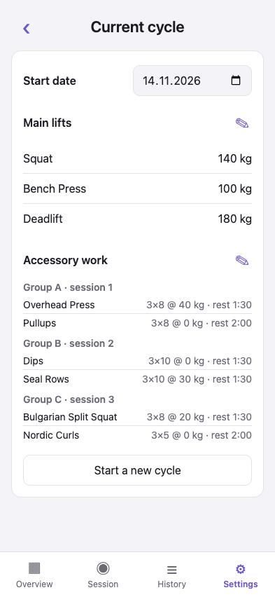 | 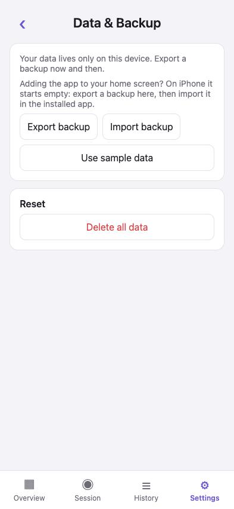 | 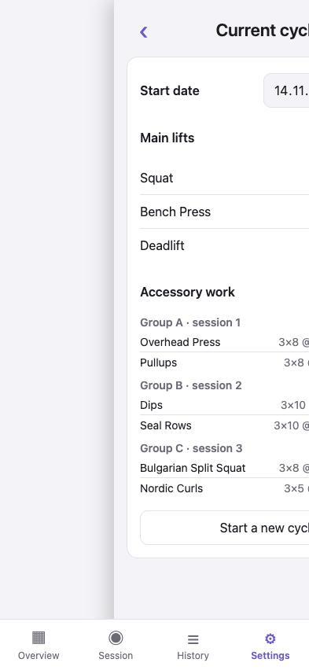 |

### Added
- **Swipe back**: on every screen with a ‹ back arrow, a swipe from the left screen edge moves
  the page with your finger. Let go past a third of the width (or flick) to go back; otherwise
  it springs back. The installed iPhone app has no system swipe-back, so this provides it.

### Changed
- **Settings** is tidier. Cards that lead to another screen are tappable as a whole and show a
  › on the right:
  - **Current cycle** shows start date, main lifts and accessory work read-only; a tap opens
    the **Current cycle** screen with the editing (start date, main lifts, accessory work,
    Start a new cycle). The accessory work editor goes back to that screen.
  - **Exercise catalog** is a single row (no pen, no description).
  - **Data & Backup** (formerly Backup) opens a screen with export, import, sample data and
    **Delete all data** (formerly its own Reset card in Settings).

---

## 0.15.0 — 2026-11-23 · Installable app, clearer rest timer

| Session | History | Finished session |
|---|---|---|
| 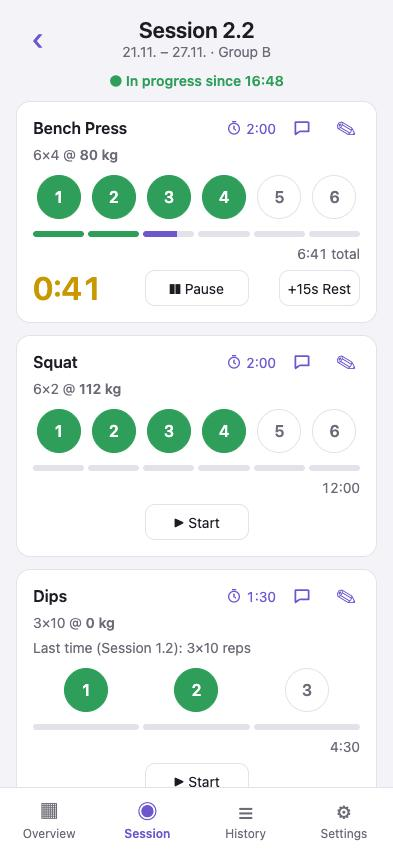 | 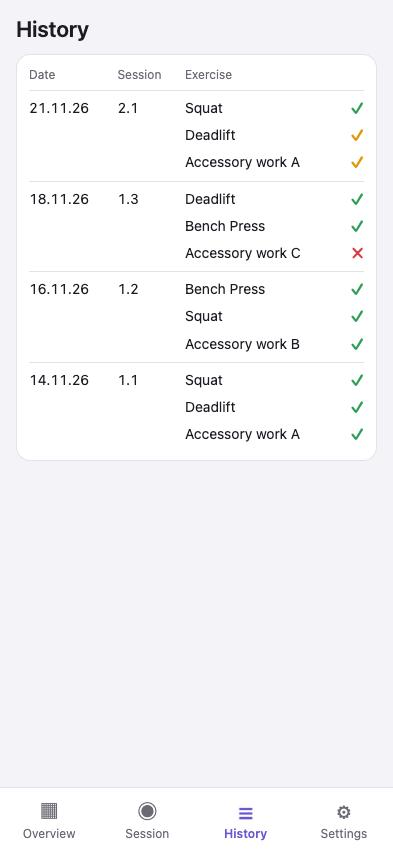 | 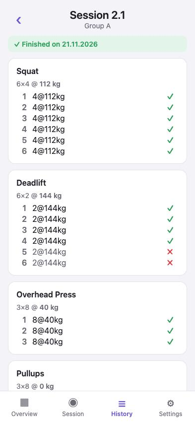 |

### Added
- **Installable app (PWA)**: add it to the home screen and it opens full screen, also without a
  network. When a new version is published, the app shows *New version available* → *Reload*;
  it never switches on its own in the middle of a workout.
- **Keep screen on** in Settings → Preferences (on by default): the screen stays on while a
  session is in progress and the app is open.
- **Big countdown**: the rest left for the current set is shown in large digits next to
  Start/Pause. Its colour shows how much is left: green from 60 s, yellow 30–59 s, orange
  15–29 s, red under 15 s; grey while paused.
- **Red ✗** for work that wasn't done: in History for an exercise or accessory group with no
  sets ticked, and in a finished session on every unticked set.

### Changed
- **+15s Rest** is now a real button next to Pause (it replaces "add 15s").
- Rest timer: segments of sets whose rest is over turn green.
- Exercise cards: the rest time (clock), a comment icon and the pen sit together in the
  header row. The comment icon opens the comment dialog and is filled once a comment is saved.
- The timer line shows only the total time left; "Paused", "Set x" and "left" are gone.
- History: accessory work is green when all its sets are ticked, even if some reps were missed.

---

## 0.14.0 — 2026-11-23 · Extra rest

| Rest timer running |
|---|
| 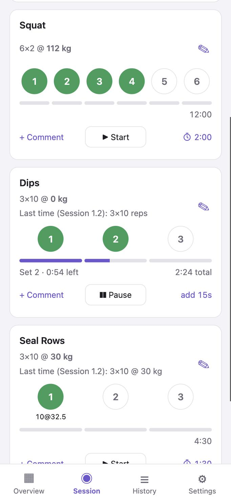 |

### Added
- **add 15s**: while a rest timer runs, the spot of the rest interval on the right becomes
  "add 15s". Each tap gives 15 seconds more rest for the current set (the remaining and total
  time grow by 15 s). Paused, stopped or done, the rest interval shows again.

### Changed
- Shorter note under Rounding in Preferences.

---

## 0.13.0 — 2026-11-23 · Rounding of planned weights

| Preferences | Session |
|---|---|
| 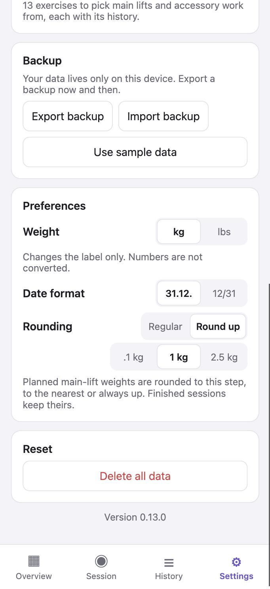 | 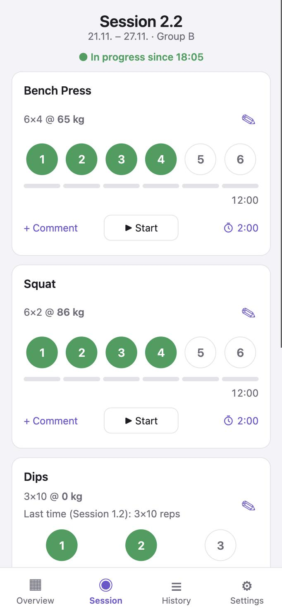 |

### Added
- **Rounding** in Settings → Preferences: planned main-lift weights (1RM × %) are rounded
  either to the nearest step (**Regular**) or always up (**Round up**), to **.1**, **1** or
  **2.5** kg/lbs (the labels follow the unit setting). The default is round up to 1 kg, so e.g.
  107 × 80% = 85.6 becomes 86 kg. Finished sessions keep their planned weights.

### Changed
- "Date" in Preferences is now "Date format".
- Two-option switches can grow wider for longer labels.

---

## 0.12.3 — 2026-11-22 · Simpler History dates

| History |
|---|
| 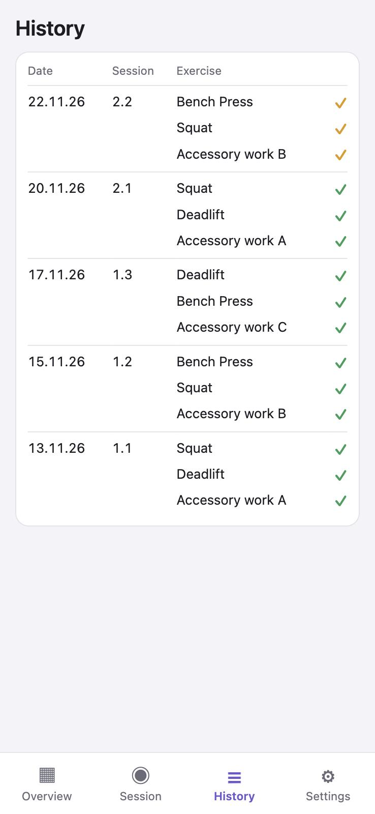 |

### Changed
- **History**: the date column shows just the date; the cycle label ("· C1") is gone. Opening
  a workout from an earlier cycle still shows its cycle in the header.

---

## 0.12.2 — 2026-11-22 · At least the plan counts, older cycles open

| History (earlier cycle) | Workout detail |
|---|---|
| 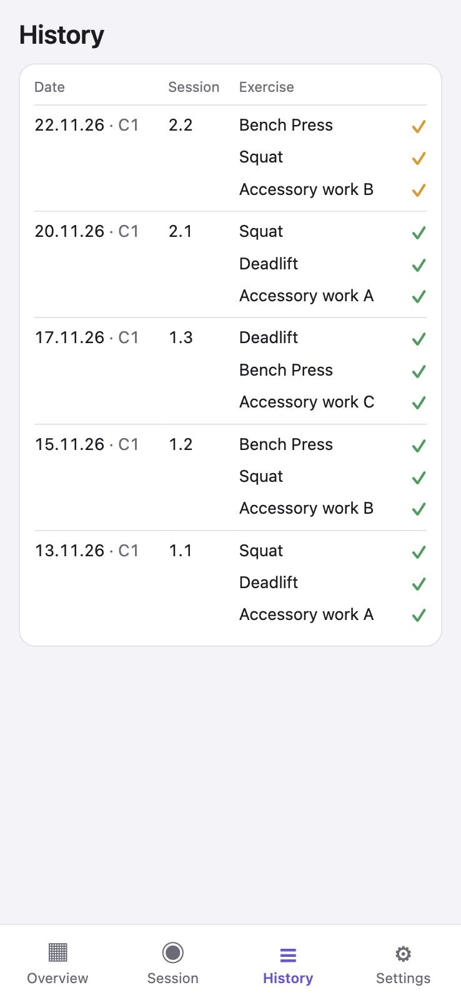 | 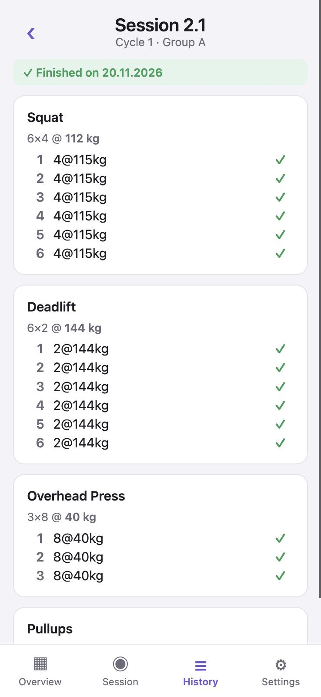 |

### Changed
- **Meeting the plan** now means at least the planned reps and at least the planned weight,
  e.g. 87.5 kg where 85.6 kg was planned because of the plates at hand. Applies to the History
  checks and the set toggles on the Session screen (yellow-green only when a set falls short).
  Extra sets count too.

### Fixed
- **History**: workouts of earlier cycles can be opened. Tapping any workout shows its finished
  session inside the History tab, with cycle and group in the header and a back arrow to the list.

---

## 0.12.1 — 2026-11-22 · Clearer checks, real back navigation

| History | Session |
|---|---|
| 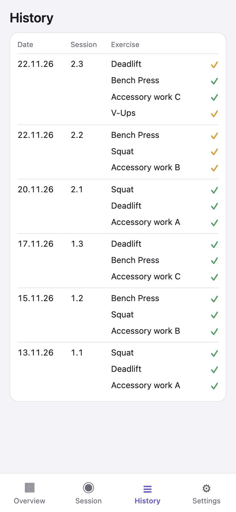 | 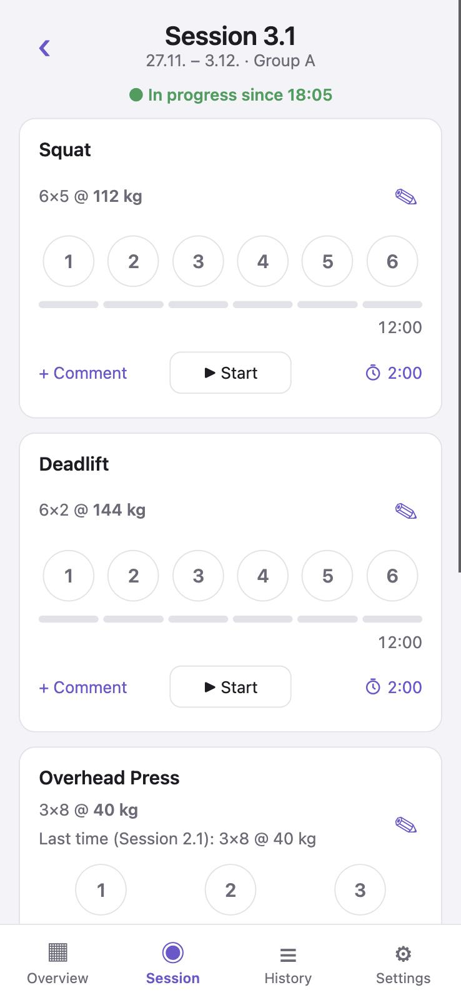 |

### Changed
- **History**: exercises not done as prescribed get an orange-yellow check instead of a grey
  one, so they stand out from the green ones.
- **Session**: the back arrow returns to the screen the session was opened from (Overview,
  History, or another session) at the same scroll position, instead of going to the previous
  planned session. The forward arrow is gone. Opened from the tab bar, there's no back arrow.

---

## 0.12.0 — 2026-11-22 · History

| History | Workout detail |
|---|---|
| 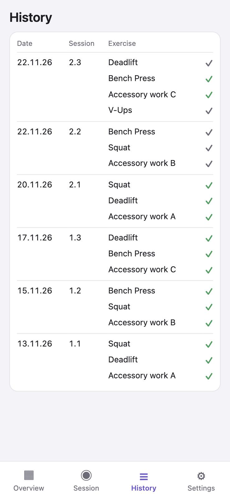 | 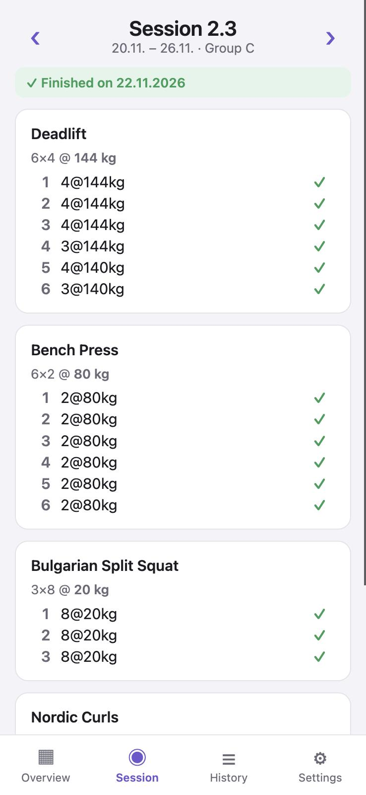 |

### Added
- **History tab**: every finished workout, newest first, as one table with date, session and
  one row per exercise: each main lift, the accessory group, and each exercise added during the
  workout. A green check means done as prescribed (every planned set ticked at the planned reps
  and weight), a grey one means not. Tapping a workout of the current cycle opens its finished
  session with all sets and weights; workouts of earlier cycles are labelled C1, C2, …
- Finished sessions remember which exercises were added during the workout.

---

## 0.11.0 — 2026-11-22 · Main lifts work like accessory work

| Session | Sets dialog (main lift) | Finished session |
|---|---|---|
| 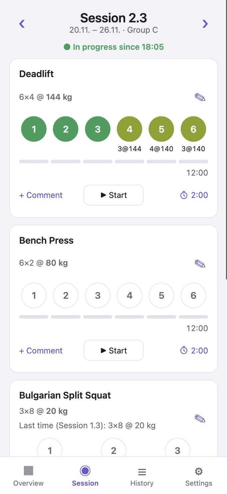 | 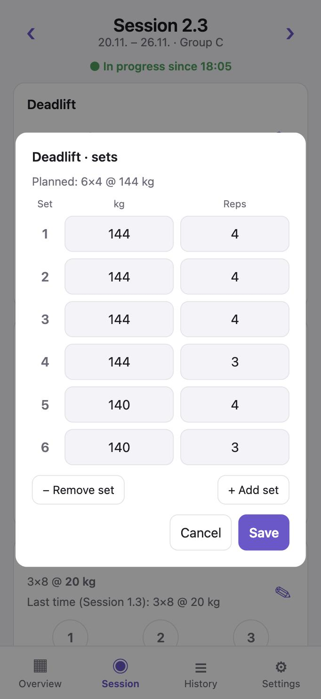 | 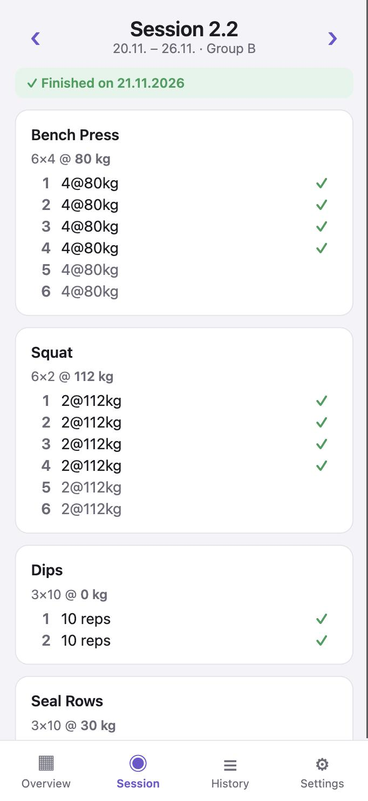 |

### Changed
- **Main-lift cards** look and work like accessory cards: no more "Weight used" in the corner;
  the pen opens the sets dialog to change the number of sets and the weight and reps of each
  set. Main lifts keep just their prescription line (no "Last time").
- **Deviations only**: under the set toggles, a set shows its reps@weight only when it differs
  from the plan, without the unit ("3@144"), so values fit on one line.
- **Yellow-green** for a set that is ticked but done differently from the plan (other reps or
  weight), instead of the full green.
- **Finished sessions** list main lifts set by set, like accessory work.
- Data: finished main lifts store every set with its own weight and reps (data version 7).
  Existing data is converted automatically; a copy of the old data is kept.

---

## 0.10.1 — 2026-11-22 · Confirmations that always work

| Added exercise | Sets dialog | Confirmation |
|---|---|---|
| 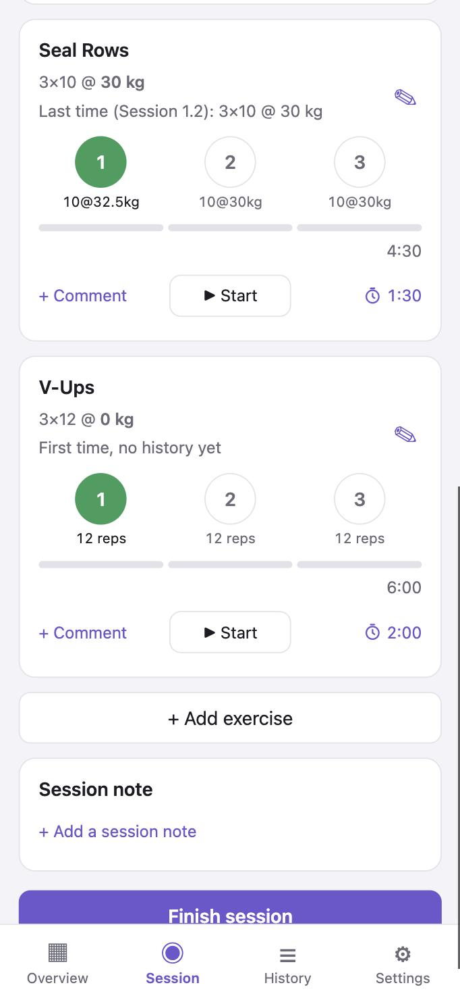 | 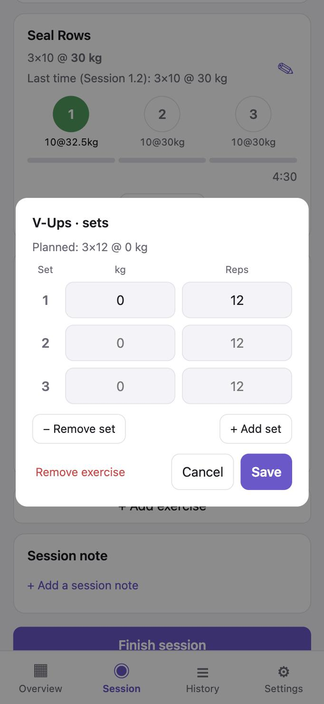 | 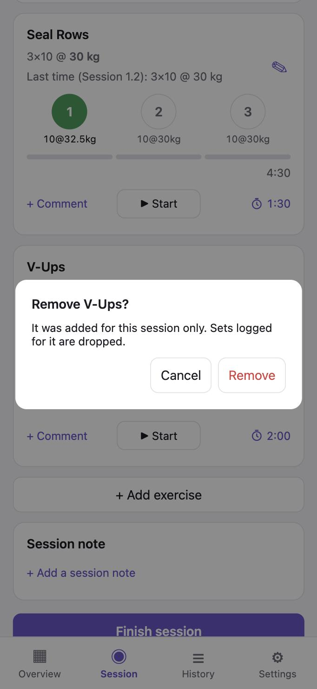 |

### Fixed
- Confirmations use the app's own dialog instead of the browser's popup, which some browsers and
  embedded views block silently (the action then did nothing). Affects removing an added
  exercise, deleting an exercise, restoring a backup, sample data, deleting all data and
  starting the next cycle.

### Changed
- An exercise added during a session is removed from the dialog behind its pen ("Remove
  exercise", a small text button left of Cancel) instead of a × on the card.

---

## 0.10.0 — 2026-11-22 · Add exercises mid-workout, reorder accessory work

| Add exercise | Added exercise | Reordering | Session | Overview |
|---|---|---|---|---|
| 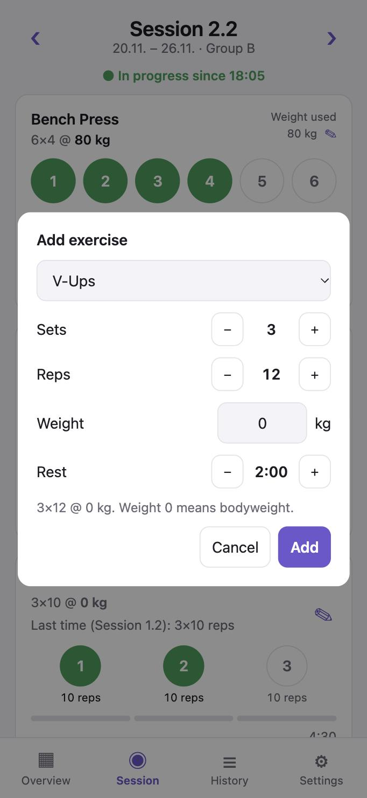 | 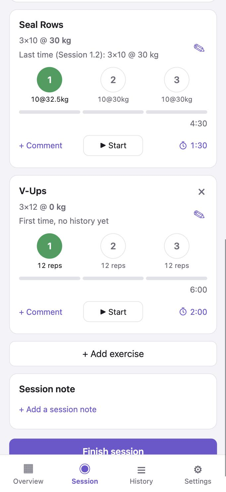 | 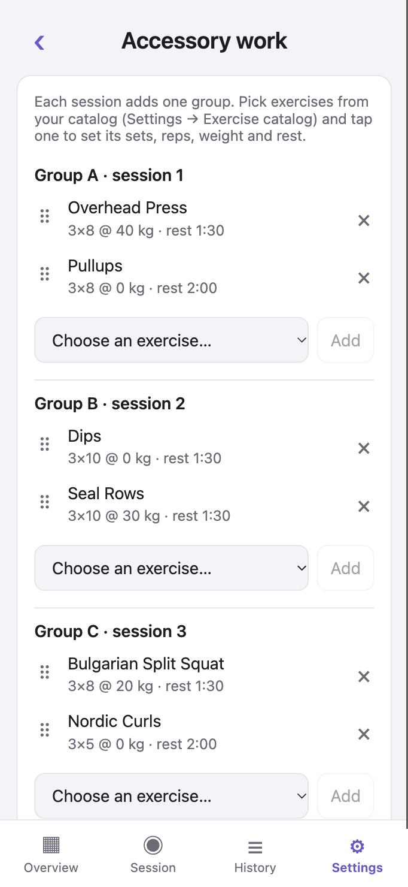 |  |  |

### Added
- **Add exercise** during a workout: a button below the accessory work opens a dialog to pick a
  catalog exercise and set sets, reps, weight and rest. The exercise is for that session only
  (the group stays as it is), behaves like the rest of the accessory work and is saved with the
  finished session, so it shows in history and "Last time". While the session is open it can be
  removed again (×), dropping its logged sets.
- **Reorder accessory work**: in the Accessory work editor each exercise has a grip handle; press
  and drag it to change the order within a group. Tapping a row and scrolling still work; arrow
  keys on a focused handle move it one step.

---

## 0.9.0 — 2026-11-21 · Tidier Settings and new tab names

Settings is reorganised: the cycle, its main lifts and its accessory work share one card, editing
happens on sub-screens, and a new cycle can be started at any time. The tabs are renamed ahead
of a redesign.

| Overview | Session | Settings | Settings (lower part) |
|---|---|---|---|
| 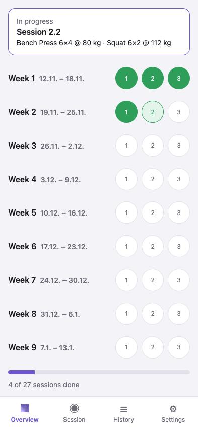 | 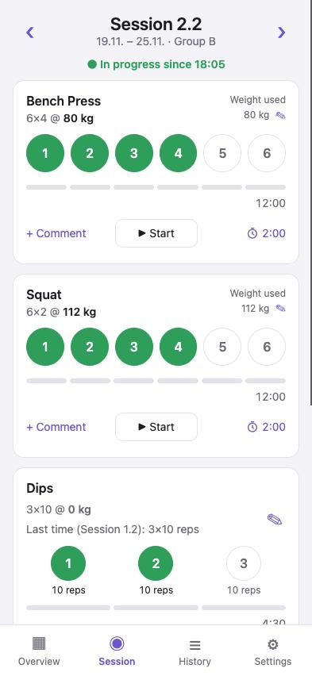 | 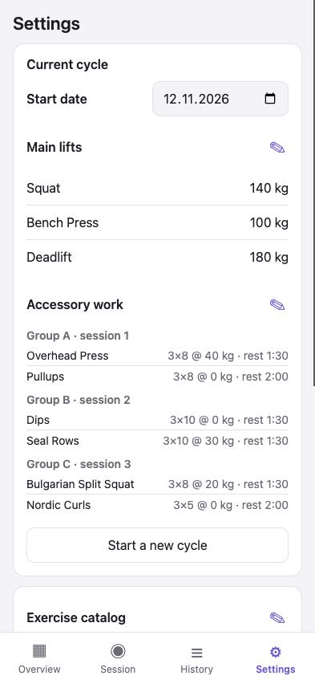 | 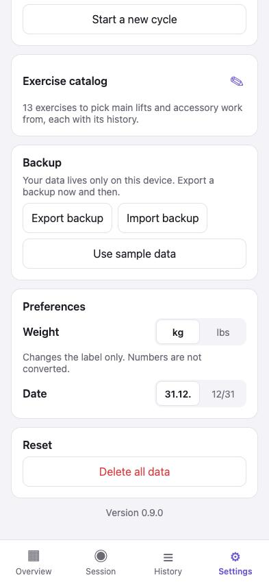 |

| Accessory work editor | Exercise catalog | New cycle |
|---|---|---|
| 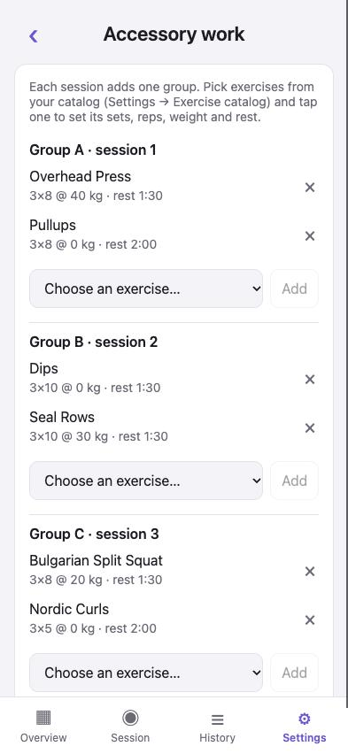 | 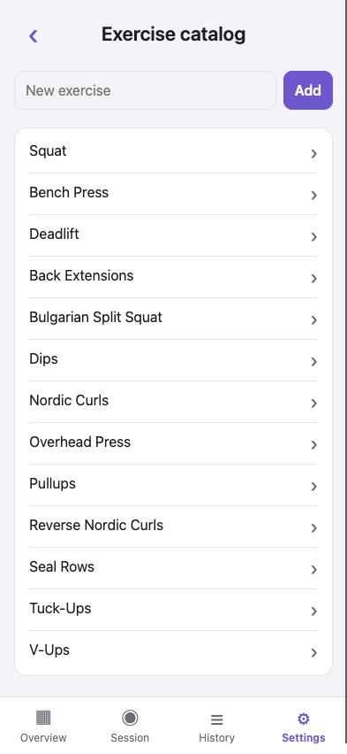 | 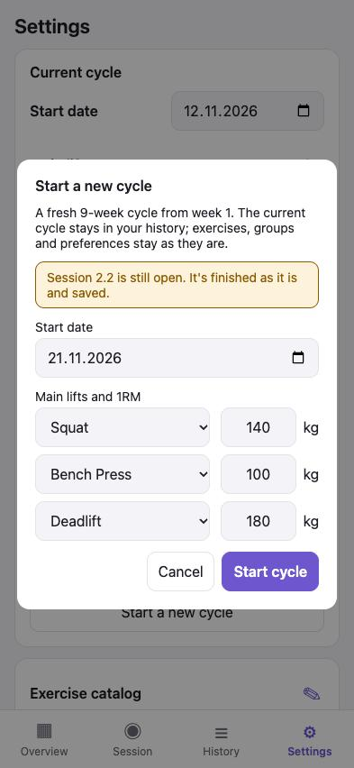 |

### Added
- **Start a new cycle** at any time (Settings → Current cycle): start date and main lifts,
  pre-filled with the current ones. The current cycle stays in the history; an open session in it
  is finished as it is. Exercises, groups and preferences are kept.
- **Exercise catalog** card in Settings; its pen opens the list of exercises (with each
  exercise's history) as a sub-screen.

### Changed
- **Current cycle** card holds start date, main lifts and accessory work, with "Start a new
  cycle" at the bottom.
- **Accessory work** shows as a compact summary, one line per exercise; its pen opens an editing
  screen with the groups, prescriptions and the add/remove controls.
- Tabs: **Plan** is now **Overview**; **Exercises** is now **History**, empty until its redesign.
  The exercise list moved to Settings → Exercise catalog.

---

## 0.8.0 — 2026-11-21 · Flexible main lifts

Main lifts are no longer fixed to squat, bench press and deadlift: any exercise from the catalog
can be one, and a cycle can have one, two or three of them.

| Main lifts (Settings) | Setup | Session | Exercise history | Plan |
|---|---|---|---|---|
| 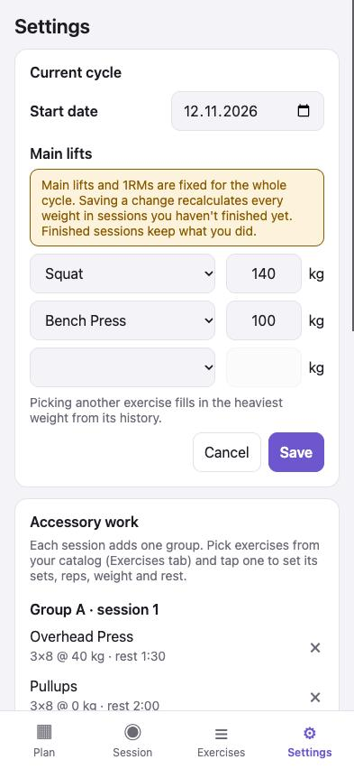 | 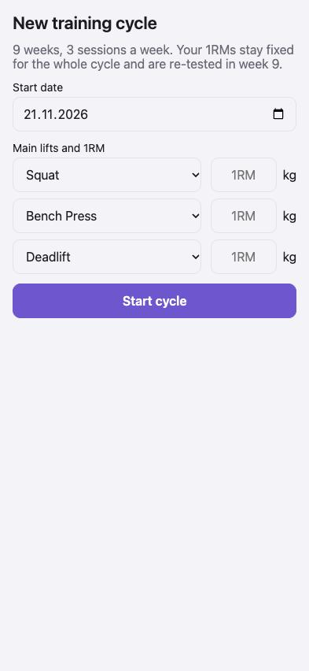 |  | 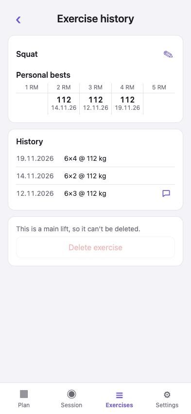 |  |

### Added
- **Main lifts** in Settings (was "1RM", now with a pen instead of the gear): edit mode has an
  exercise dropdown and a 1RM field per slot. Picking another exercise fills in the heaviest
  weight from its history; you can overwrite it. An exercise can only be in one slot.
- **One, two or three main lifts**: each dropdown has an empty entry. An empty slot's sets are
  left out of the whole cycle; sessions without a main lift show only their accessory work. At
  least one lift is required.
- The first-launch setup gets the same dropdowns (Squat / Bench Press / Deadlift by default).

### Changed
- Changing main lifts or 1RMs recalculates sessions you haven't finished; finished sessions
  keep what you did.
- Default exercise names all in title case ("Bench Press").
- Exercise history: the exercise name shows once, on the first card (the subtitle under the
  title is gone).
- Code clean-up: one shared dialog component for all dialogs, one component for the
  "6×4 @ 80 kg" line, shared limits for rest times and set counts, unused code removed.

### Fixed
- The rename dialog no longer saves an empty name when Enter is pressed.

---

## 0.7.0 — 2026-11-21 · Exercise history and personal bests

Each exercise gets its own history with personal bests, dates can be shown US-style, and the
app can be filled with sample data to try it out.

| Exercise history | Comment | Session | Plan |
|---|---|---|---|
|  | 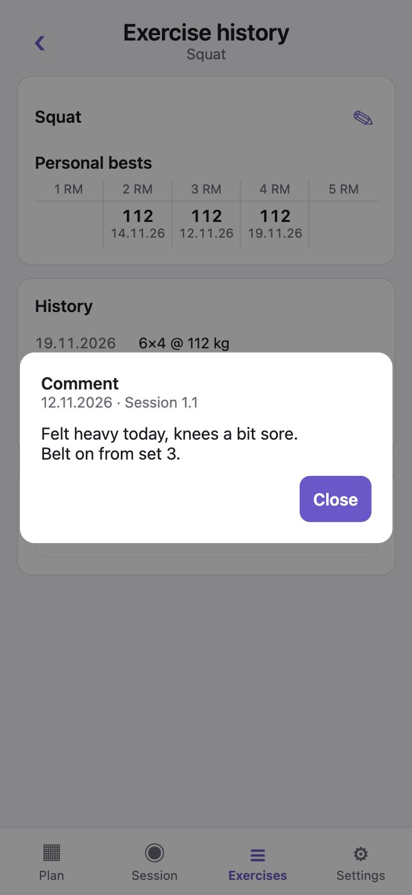 | 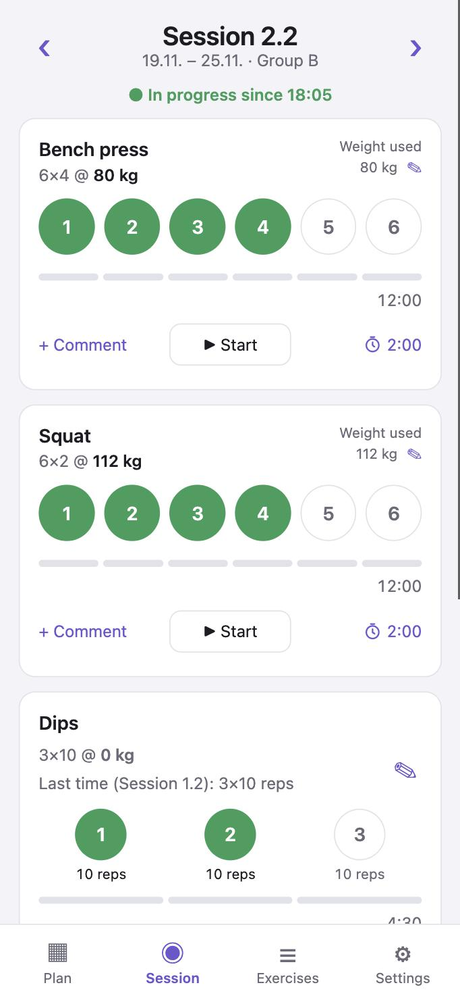 |  |

| Settings |
|---|
|  |

### Added
- **Exercise history** (Exercises → tap an exercise): every finished session the exercise was
  done in, newest first, as date and done sets ("6×4 @ 112 kg", same format as "Last time").
  A bubble icon opens the comment written on that card.
- **Personal bests**: the heaviest ticked set for exactly 1, 2, 3, 4 and 5 reps, each with the
  date it was first lifted. Empty means never done for that many reps; 0 means bodyweight.
- **Date format** in Settings → Preferences: 31.12. or 12/31, for week ranges, finished
  sessions and the history.
- **Use sample data** in Settings → Backup: a cycle in its second week with four finished
  sessions and Session 2.2 in progress today. Replaces the current data after a confirmation and
  keeps your unit and date format.

### Changed
- The exercise name is shown as text with a pen that opens a rename dialog; Delete moved to its
  own card at the bottom.
- The Units card is now **Preferences**, with a quieter switch (white pill on a gray track).

---

## 0.6.0 — 2026-11-21 · Units and tidier cards

Main lifts and accessory work now use the same "3×10 @ 30 kg" style, "Last time" is a compact
summary, and weights can be labelled in kg or lbs.

| Session | Accessory work | Plan |
|---|---|---|
|  |  |  |

| Accessory work (Settings) | Units |
|---|---|
|  |  |

### Added
- **Units** card in Settings, between Backup and Reset: switch between kg and lbs. It changes the
  label everywhere (history included); numbers are not converted.

### Changed
- Main lifts show their prescription as "6×4 @ 80 kg" instead of percentages, on the Session
  card, in finished sessions and in the Plan's Next up card.
- "Last time" on accessory cards is a compact summary: sets with the same weight are grouped in
  order, equal reps as "3×10", different reps as "10-9-7", e.g. "2×10 @ 40 kg, 10-7 @ 45 kg".
  Bodyweight-only work reads "3×10 reps". Only ticked sets count.
- Accessory cards: the pen sits beside the two text lines and is larger, and the set columns line
  up with the timer segments below.
- "Secondary groups" is now called **Accessory work**.

### Removed
- The group pill on accessory cards and the "sets × interval" text on the timer.

---

## 0.5.0 — 2026-11-20 · Rest timer and prescribed accessories

Every exercise card gets an interval timer, secondary exercises get a prescription, and their
cards are much more compact. The app is now online at
[mrnh.github.io/training-cycle-app-react](https://mrnh.github.io/training-cycle-app-react/).

| Session | Secondary exercises | Editing sets | Plan |
|---|---|---|---|
|  |  |  |  |

| Groups (Settings) | Prescription | Exercises |
|---|---|---|
|  |  |  |

### Added
- **Rest timer** on every exercise card in the open session: a bar with one segment per set,
  "Set 2 · 1:12 left" and the total time. Start runs it for interval × sets; ticking sets doesn't
  change it. Pause / Resume, and a reset icon while paused. One timer runs at a time, and it
  keeps the right time after a reload or switching apps. The clock (default 2:00) opens a dialog
  to set the interval, 0:15 to 10:00 in 15-second steps.
- **Prescriptions for secondary exercises:** in Settings, each group entry holds sets, reps,
  weight (0 = bodyweight) and its rest interval, edited in a dialog. Session cards show it
  ("3×10 @ 30 kg"), pre-fill the sets with it and start the timer with its rest time. "Last time"
  stays as a reference. Finished sessions keep the prescription they had.
- **Ten more default exercises:** Back Extensions, Bulgarian Split Squat, Dips, Nordic Curls,
  Overhead Press, Pullups, Reverse Nordic Curls, Seal Rows, Tuck-Ups and V-Ups.
- **Online version** on GitHub Pages, published automatically from every push to `main`. Data
  still stays on each device.

### Changed
- **Compact secondary cards:** numbered set toggles like the main lifts, each set's values under
  it, and a pen that opens a dialog to edit weight and reps of all sets and add or remove sets.
- Sessions are named "Session 1.2" everywhere (was "W1 S2" and "Week 1 · Session 2").
- Sets are written reps@weight ("8@15kg"), matching "6×4 @ 80%"; without external weight just
  "10 reps".
- Finish dialog: "Marking this session as finished prevents it from being changed afterwards."
- All sizes, colours, weights and spacing come from one set of design tokens (`index.css`):
  five text sizes, two weights, a 4px spacing scale.

### Data
- Group entries now store their prescription and rest; existing ones get 3×10 @ 0 kg and 2:00.
  The new default exercises are added unless one with the same name exists. A copy of the data
  from before each conversion is kept on the device.

---

## 0.4.0 — 2026-11-20 · Starting a session

Sessions are now started and finished in order, with only one open at a time.

| Plan | Session in progress | Starting the next one | Preview |
|---|---|---|---|
|  |  |  |  |

### Added
- **Start session:** the next session in order has a "Start session" button at the top. Only a
  started session can be logged, and only it shows "Finish session" at the bottom. It shows
  when it was started ("In progress since 18:05").
- **One open session at a time:** starting the next session while one is still open finishes the
  open one as it is, after a dialog that lists its main-lift sets not ticked.
- **Preview:** every other unfinished session shows its planned lifts, weights and secondary
  exercises without any controls, and links to the session to do first.

### Changed
- Plan: the top card says "In progress" while a session is open, otherwise "Next up". The open
  session's dot is light green.
- The Session tab opens the session in progress, otherwise the next one to start.

### Data
- Each cycle stores its open session. Sessions that were started but not finished before this
  version are removed when the data is converted; finished sessions stay. A copy of the data from
  before the conversion is kept on the device.

---

## 0.3.0 — 2026-11-19 · Exercise catalog and finishing sessions

Exercises now live in one catalog that the groups pick from, and a session is saved permanently
once you finish it.

| Plan | Session | Finishing | Finished session |
|---|---|---|---|
|  |  |  |  |

| Exercises | One exercise | Groups (Settings) | Cycle complete |
|---|---|---|---|
|  |  |  |  |

### Added
- **Exercise catalog:** the Exercises tab lists every exercise, including squat, bench press and
  deadlift. Each row opens the exercise's screen (rename and delete for now; its history comes
  later). Deleting is blocked while an exercise is a main lift or in a group.
- **Groups in Settings:** groups A, B and C pick exercises from the catalog. One exercise can be in
  several groups, and a main lift can also be a secondary exercise.
- **Finish session:** an open session is a draft that is saved on every tap. "Finish session"
  (confirmed in a dialog that lists main-lift sets not ticked) saves it permanently. Finished
  sessions are shown read-only, and later group or name changes don't affect them.
- **Cycle complete:** once week 9 session 3 is finished, Plan shows the new 1RMs and "Start next
  cycle". A re-test that wasn't ticked keeps the old 1RM.

### Changed
- Plan dots, "x of 27 sessions done", "last time" hints and the re-test results count finished
  sessions only.
- Each cycle stores which exercises are its three main lifts (squat, bench press and deadlift;
  there is no screen to change them yet).
- Tapping the tab you're on returns it to its first screen.

### Data
- Stored data and older backups are converted automatically. Sessions whose main-lift sets were
  all ticked become finished sessions; the rest stay drafts. A copy of the data from before each
  conversion is kept on the device.

---

## 0.2.0 — 2026-11-19 · Redesigned session cards

The main lifts in a session are now one compact card each: tap a numbered button per set instead
of filling in a row per set.

| Session | Changing the weight | Plan | Exercises | Settings |
|---|---|---|---|---|
|  |  |  |  |  |

### Changed
- **Main-lift cards:** one card per lift with numbered set buttons (48 px) spread across the card,
  instead of a row with weight, reps and tick for every set. Ticked sets turn green.
- **Prescription line** "6×3 @ 80% · **80 kg**": the planned weight is bold, in the lift name's
  colour (black, or white in dark mode).
- **Weight used** is shown top right as text with a pen icon, aligned with its label. Removed the
  "Variant" pill and the reps field (reps come from the prescription).

### Added
- **Weight dialog:** the pen opens a dialog showing the planned weight, with a number field,
  "Use planned weight", Cancel and Save. The new weight applies to all sets of that lift; a weight
  that differs from the plan is shown in purple.

### Fixed
- Exercise history and "last time" only count sets that were actually ticked. Before, changing the
  weight of a lift before training showed up as six empty sets in its history.

---

## 0.1.0 — 2026-11-19 · First version

The first usable version: a 9-week cycle of the Russian Masters Squat Routine, adapted for squat,
bench press and deadlift, with three sessions a week.

| Plan | Session | Secondary exercises | Exercises | Settings |
|---|---|---|---|---|
|  |  |  |  |  |

### Added
- **Plan:** "Next up" card, 9 weeks × 3 sessions with dates (`23.11. – 29.11.`), session dots for
  done / next / started, and a progress bar with "x of 27 sessions done". Fits one iPhone screen
  without scrolling.
- **Session:** sets with weight, reps and a tick. Values save instantly — no "finish" button.
  Previous/next arrows to move between sessions.
- **Program rules:** each session pairs one lift's variant 2 (progressing volume, then intensity)
  with another lift's variant 1 (6×2 @ 80%). Weights are 1RM × %, rounded to one decimal.
- **Re-test:** the week-9 single at 105% becomes the 1RM for the next cycle; "Start next cycle"
  appears once all three re-tests are done, and old cycles stay in the history.
- **Secondary exercises** in groups A/B/C (one group per session), with "last time" hints,
  adjustable set count and per-exercise history.
- **Comments** per exercise and a note per session.
- **Settings:** start date and 1RM in one "Current cycle" box; 1RM editing behind the gear icon with
  a warning and Cancel/Save; backup export/import (JSON); delete all data; version number.
- **Storage:** everything is kept on the device in IndexedDB, works without a server.
- Mobile layout: bottom tab bar, large tap targets, light and dark mode, safe-area support.

### Fixed during development
- The Session tab no longer jumps to the next session when the last set is ticked.
- Date fields no longer overflow their box in iPhone Safari.
- Starting a cycle and adding exercises work when the app is opened over the local network (plain http).
