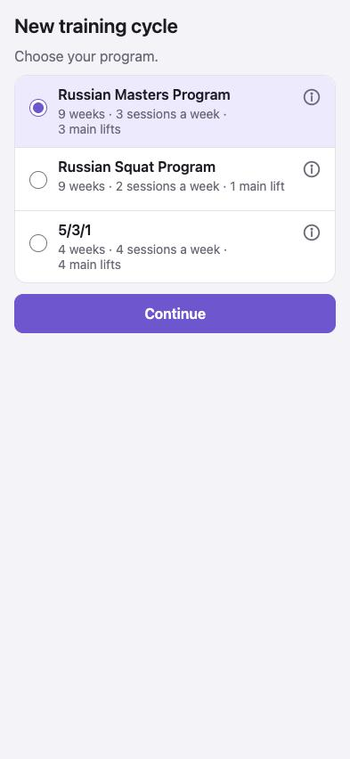
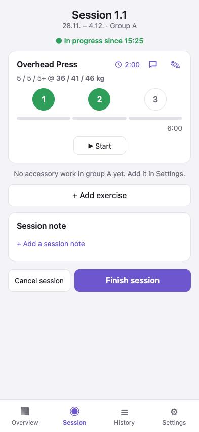
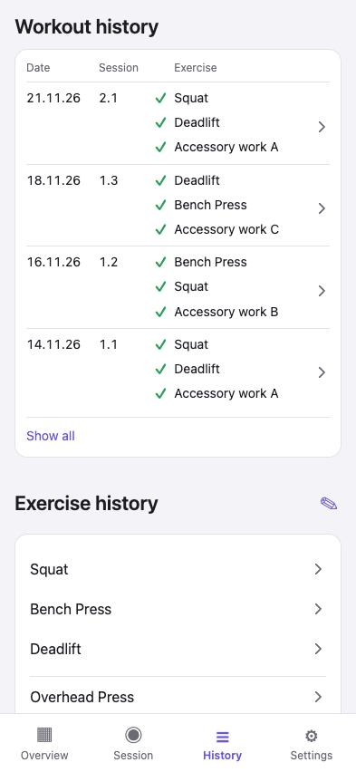
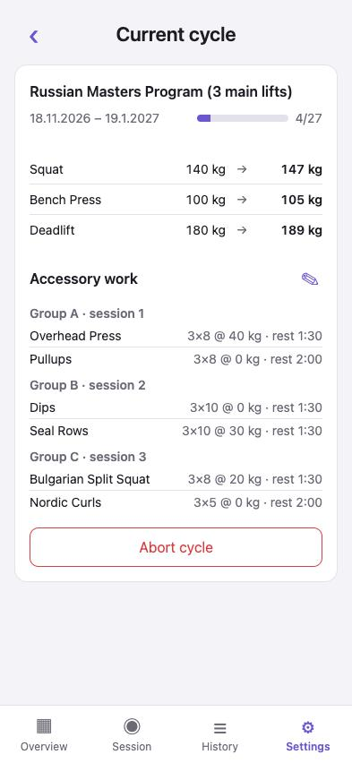

# Training Cycle App

A mobile-first React app for strength training cycles: pick a program, enter your main lifts
and numbers, and log every session. It comes with three programs, each with its own plan:

- **Russian Masters Program:** 9 weeks, three sessions a week, squat, bench press and deadlift
- **Russian Squat Program:** the same idea for a single lift, 18 sessions in 6 to 9 weeks
- **5/3/1** (Jim Wendler): 4-week blocks for squat, bench press, overhead press and deadlift, on
  three or four days a week

Programs are plain data (see Development), so more can be added.

- **Programs:** choose a program when you start a cycle, with its options (such as training days
  per week) and a description of its aim and who it suits. The same screen starts every later
  cycle, which can use another program.
- **Overview:** all sessions of the cycle at a glance, with progress
- **Session:** start a session (in any order; a warning shows when earlier ones are unfinished),
  tick sets and log weight and reps; values save instantly, and "Finish session" stores the
  workout permanently. One session is open at a time; starting another finishes it, and "Cancel session" discards the open one without a trace. Each exercise has a rest timer, and exercises can be added for the
  session
- **History:** every finished workout, newest first, with a check per exercise for done as
  prescribed; tap one for its sets and weights, and "Edit" to correct what was logged wrong
- **Settings:** the current cycle (its program, dates, main lifts and numbers, and the accessory
  work of each group, which belongs to the program), aborting a cycle, the exercise catalog (each
  exercise with its history and personal bests for 1 to 5 reps), kg/lbs, date format and rounding
  of planned weights, language, appearance and app icon, backup export/import and sample data

Programs with a re-test (the two Russian ones) end with a single at 105%, which becomes the 1RM
for the next cycle. 5/3/1 suggests the usual increases for the next cycle instead.

**Use it:** [mrnh.github.io/training-cycle-app-react](https://mrnh.github.io/training-cycle-app-react/)
(published from `main` on every push).

Data is stored locally in the browser (IndexedDB), on each device separately. Use **Export backup** in Settings to keep a copy.

### Install on your phone

The app is a PWA: it can be added to the home screen and then works offline, full screen and
with its own icon.

- **iPhone (Safari):** Share → *Add to Home Screen*.
- **Android (Chrome):** menu → *Install app* (or *Add to Home screen*).

On iPhone the installed app has **its own storage, separate from Safari**, so it starts empty.
Move your data once: in Safari, Settings → *Export backup*; in the installed app, Settings →
*Import backup*. When a new version is published, the app shows *New version available* →
*Reload*; it never switches in the middle of a workout on its own.

<p>
  
  
  
  
</p>

See the [changelog](CHANGELOG.md) for how the app has developed, with screenshots of each version.

## Versions

Every push to `main` bumps the patch version (`npm version patch --no-git-tag-version`: 0.27.1,
0.27.2, ...) in `package.json`, without a changelog entry; the app then offers a plain "New version
available". A release below bumps the minor version and starts again at .0.

## Releasing a new version

1. Bump `version` in `package.json` (`npm version minor --no-git-tag-version` or `patch`).
   To test the real build (offline copy, update prompt): `npm run build && npm run preview`,
   then open `http://localhost:4173/training-cycle-app-react/`. After changing `public/icon.svg`,
   run `npm run icons`.
2. Add screenshots to `docs/screenshots/vX.Y.Z/` and a new entry at the top of `CHANGELOG.md`.
   The entry's title (after the "·") and its sections become the app's update message ("New
   version X.Y.Z · title · What's new"), so keep the heading format
   `## X.Y.Z — YYYY-MM-DD · Title` and the `### Added` / `### Changed` lists.
3. Commit, then tag and push: `git tag -a vX.Y.Z -m "vX.Y.Z" && git push --follow-tags`.

## Development

```bash
npm install
npm run dev
```

All texts shown in the app are in `src/locales/en-US.js`, grouped by screen, and used in the code as
`t('settings.cycle.abort')` (`src/i18n.js`: variables like `{name}`, plural forms by `count`). To add a
language, add a file with the same keys next to it (as `de.js` does for German; `en-GB.js` only lists what differs from American English) and register it in
`i18n.js`; `npm run check-texts` lists missing keys. The language is picked in Settings →
Preferences; the app starts in American English and does not follow the device. Not translated yet:
the changelog notes, the default exercise names and the app name in `index.html` and the manifest.

The training programs (weeks, sessions, sets and percentages, and their options) are plain data in
`src/programs.js`; the rules that work on them live in `src/program.js`, storage in `src/store.js`,
screens in `src/screens/`. Each cycle stores the id of its program and the options chosen
(`cycle.program`, `cycle.options`; cycles from before programs existed use the default program).

## License

[GNU General Public License v3.0 or later](LICENSE). Anyone may use, change and share this app.
Software that includes it or is built on it must be released under the same license, with its
source code.
