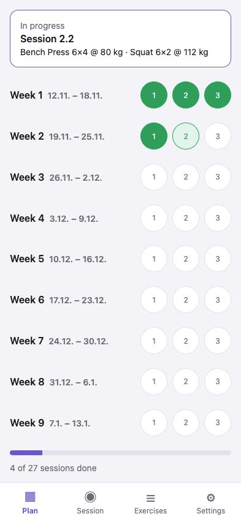
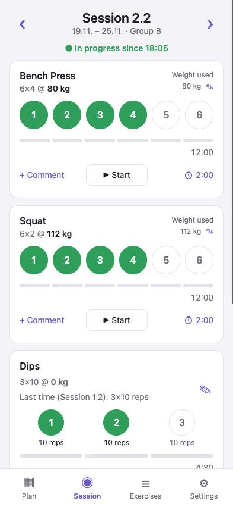

# Training Cycle App

A mobile-first React app for a 9-week strength cycle with three sessions a week, based on the
Russian Masters Squat Routine adapted for up to three main lifts (squat, bench press and deadlift
by default).

- **Overview:** all 27 sessions at a glance, with progress
- **Session:** start the next session in order, tick sets and log weight and reps; values save
  instantly, and "Finish session" stores the workout permanently. One session is open at a time;
  the others are previews. Each exercise has a rest timer
- **History:** empty for now, being redesigned
- **Settings:** start date, up to three main lifts with their 1RM, accessory work groups A/B/C with
  sets, reps, weight and rest for each, the exercise catalog (each exercise with its history and
  personal bests for 1 to 5 reps), kg/lbs and date format, backup export/import and sample data

The week-9 single at 105% is the re-test and becomes the 1RM for the next cycle.

**Use it:** [mrnh.github.io/training-cycle-app-react](https://mrnh.github.io/training-cycle-app-react/)
(published from `main` on every push).

Data is stored locally in the browser (IndexedDB), on each device separately. Use **Export backup** in Settings to keep a copy.

<p>
  
  
  
</p>

See the [changelog](CHANGELOG.md) for how the app has developed, with screenshots of each version.

## Releasing a new version

1. Bump `version` in `package.json` (`npm version minor --no-git-tag-version` or `patch`).
2. Add screenshots to `docs/screenshots/vX.Y.Z/` and a new entry at the top of `CHANGELOG.md`.
3. Commit, then tag and push: `git tag -a vX.Y.Z -m "vX.Y.Z" && git push --follow-tags`.

## Development

```bash
npm install
npm run dev
```

Program rules live in `src/program.js`, storage in `src/store.js`, screens in `src/screens/`.

## License

[GNU General Public License v3.0 or later](LICENSE). Anyone may use, change and share this app.
Software that includes it or is built on it must be released under the same license, with its
source code.
